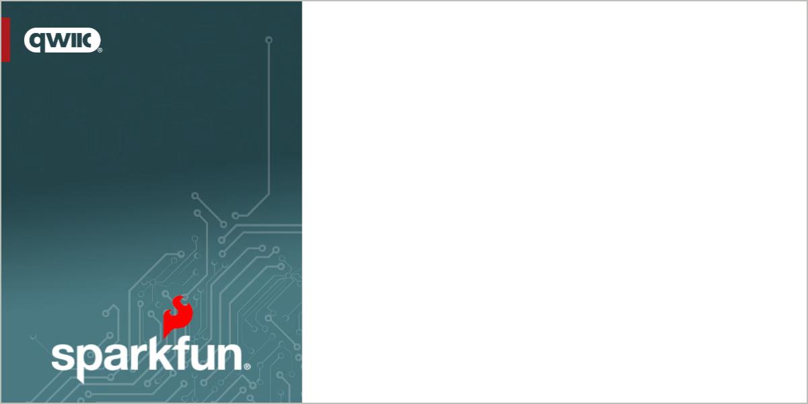

# SparkFun BMI330 Arduino Library

Arduino library for the SparkFun Qwiic BMI330 breakout, built around the Bosch BMI330 6-DoF IMU.


[](https://github.com/sparkfun/SparkFun_BMI330_Arduino_Library/actions/workflows/cross-compilation.yml)


The BMI330 pairs a 16-bit triaxial accelerometer with a 16-bit triaxial gyroscope, a temperature
sensor, a 2 kB FIFO, two interrupt pins, and an on-chip feature engine that detects motion events
without the host doing any work. It is Bosch's extended-temperature successor to the BMI270, and it
is considerably easier to live with: every feature lives in ROM, so there is no configuration blob
to upload and no boot wait before the first sample.

This library allows you to:

* Read acceleration, angular rate, die temperature and a hardware timestamp in one transaction
* Talk to the board over **I2C or SPI** with identical code above the bus layer
* Set output data rate, full-scale range, filter bandwidth, hardware averaging and power mode
* Use **both interrupt pins**, with any source routed to either one independently
* Buffer samples in the **2 kB FIFO** with watermark and full interrupts, and decode frames
* Run the **feature engine** - any-motion, no-motion, significant motion, tilt, orientation, flat,
  single/double/triple tap, step detector and step counter
* Remap axes inside the device, so the fix applies to the features as well as the data
* Run **self-test** and **gyroscope self-calibration**, and set user offsets

## Quick Start

```cpp
#include <SparkFun_BMI330.h>

SfeBMI330ArdI2C myIMU;

void setup()
{
    Serial.begin(115200);
    Wire.begin();

    while (myIMU.begin() == false)
    {
        Serial.println("BMI330 not found - check your wiring!");
        delay(1000);
    }

    // Both sensors power up disabled. Turn them on.
    myIMU.setAccelConfig(BMI330_ACCEL_MODE_HIGH_PERF, BMI330_ODR_100_HZ, BMI330_ACCEL_RANGE_4G);
    myIMU.setGyroConfig(BMI330_GYRO_MODE_HIGH_PERF, BMI330_ODR_100_HZ, BMI330_GYRO_RANGE_500DPS);
}

void loop()
{
    sfe_bmi330_sensor_data_t data;
    myIMU.getSensorData(data);

    Serial.print(data.accel.x, 3);
    Serial.print(" g, ");
    Serial.print(data.gyro.z, 1);
    Serial.println(" dps");

    delay(100);
}
```

### Five things worth knowing up front

**Both sensors power up disabled.** `begin()` leaves them that way, matching the device's own
power-on state. A sketch that calls `begin()` and immediately reads gets zeros. This is deliberate:
the right power mode is an application decision, and defaulting to high-performance would cost
current on a battery design that wanted low-power mode.

**No configuration file.** The BMI270 will not report a single sample until the host uploads an
8 kB firmware blob and waits for it to boot. Every BMI330 feature lives in ROM. `begin()` is a chip
ID check and a feature-engine enable, and this library carries no vendor binary.

**The default I2C address is 0x68.** Close the board's ADR jumper for `0x69`. `SfeBMI330ArdI2C::findDevice()`
will check both and confirm the chip ID, so a sketch does not have to know how the jumper is set.

**Temperature is `raw / 256 + 23`, not `raw / 512 + 23`.** The BMI323 uses 512. If you are porting
a BMI323 driver, this is the line that silently reports half the true excursion from 23 °C. The
library handles it in `rawToCelsius()`.

**Enabling a feature takes two writes.** Setting a bit in `FEATURE_IO0` does nothing until the host
writes the commit register. `enableFeature()` does both. A hand-rolled driver that skips the commit
reads the enable bits back correctly and the feature stays off - a quiet failure worth knowing about.

## Hardware

### I2C (default)

Plug a Qwiic cable in. That is the whole procedure.

| Breakout | Host        |
| -------- | ----------- |
| Qwiic    | Qwiic       |
| INT1     | any input pin (optional) |
| INT2     | any input pin (optional) |

### SPI

The SPI pins are broken out as well, and the same driver handles them.

| Breakout | Host         |
| -------- | ------------ |
| SDI      | COPI (MOSI)  |
| SDO      | CIPO (MISO)  |
| SCK      | SCK          |
| CS       | any output pin |
| 3V3      | 3V3          |
| GND      | GND          |

```cpp
SfeBMI330ArdSPI myIMU;
myIMU.begin(10);   // chip select on D10
```

SPI is worth the extra wires in two situations. The first is throughput: at 6400 Hz with both
sensors running, each sample is 16 bytes of payload, which is over 100 kB/s and eats most of a
400 kHz I2C bus. A 4 MHz SPI link moves it in a few percent of its capacity. The second is
addressing - the board has one ADR jumper, so I2C tops out at two BMI330s per bus, where SPI needs
only another chip select.

One BMI330 quirk the library handles for you: the device powers up undecided about its interface
and commits to SPI on the first CS edge it sees, so the first transfer returns garbage *by design*.
The library performs and discards that read inside `begin()` and after every `softReset()`. A
hand-rolled driver without it usually fails to read the chip ID on the first try.

### Interrupts

Both pins are brought out, and every source is routed independently:

```cpp
myIMU.mapInterrupt(BMI330_INT_SRC_ACCEL_DRDY, BMI330_INT1);   // data ready on INT1
myIMU.mapInterrupt(BMI330_INT_SRC_ANY_MOTION, BMI330_INT2);   // motion on INT2
```

Splitting sources across the two pins lets an ISR tell events apart without a bus transaction,
which is the difference between a clean wake and a read that has to happen before the sketch knows
whether it needed to.

Interrupt status registers are **clear-on-read**: one call to `getInterruptStatus()` consumes every
pending flag for that pin. Read once and test the whole returned word against the
`sfe_bmi330_int_status_t` masks.

The board fits no interrupt pull-up, so supply one externally if you configure the pins as
open-drain.

## Examples

| Example | What it covers |
| ------- | -------------- |
| [Example01_BasicReadingsI2C](examples/Example01_BasicReadingsI2C) | Acceleration, rate and temperature over Qwiic |
| [Example02_BasicReadingsSPI](examples/Example02_BasicReadingsSPI) | The same sketch over SPI - compare the two |
| [Example03_Configuration](examples/Example03_Configuration) | Range, ODR, bandwidth and averaging, with measured noise at each; the ERR_REG configuration-error flag |
| [Example04_DataReadyInterrupt](examples/Example04_DataReadyInterrupt) | One read per sample, paced by INT1 |
| [Example05_FIFOBuffer](examples/Example05_FIFOBuffer) | Watermark interrupts and headerless frame decoding |
| [Example06_WakeOnMotion](examples/Example06_WakeOnMotion) | Any-motion wakes to full rate, no-motion drops to low power - the battery-design pattern |
| [Example07_TapDetection](examples/Example07_TapDetection) | Single, double and triple tap |
| [Example08_StepCounter](examples/Example08_StepCounter) | Step detector and step counter with a watermark |
| [Example09_TiltOrientationFlat](examples/Example09_TiltOrientationFlat) | Three posture features on one pin |
| [Example10_SelfTest](examples/Example10_SelfTest) | Per-axis health check of both sensors |
| [Example11_SelfCalibration](examples/Example11_SelfCalibration) | Measuring and correcting gyroscope offset |
| [Example12_AxisRemap](examples/Example12_AxisRemap) | Correcting a mounting orientation inside the device |

Significant motion (`setSigMotionConfig()`, `BMI330_FEAT_SIG_MOTION`) follows exactly the same
configure / map / enable pattern as Example06 and has no example of its own.

[extras/TapDiagnostic](extras/TapDiagnostic) is a bench utility rather than an example: it dumps
the feature-engine state, measures which axis your taps land on, and sweeps the tap detector across
X, Y and Z.

## Key Specifications

| | |
| --- | --- |
| Accelerometer range | ±2 / ±4 / ±8 / ±16 g (16384 / 8192 / 4096 / 2048 LSB/g) |
| Gyroscope range | ±125 / ±250 / ±500 / ±1000 / ±2000 dps (262.144 … 16.384 LSB/dps) |
| Output data rate | 0.78 Hz to 6400 Hz |
| FIFO | 2048 bytes (1024 words) |
| Sensor time resolution | 39.0625 µs per LSB |
| Temperature | 256 LSB/K, zero at 23 °C, −41 °C to +87 °C |
| Supply | VDD 1.71–3.63 V, VDDIO 1.08–3.63 V |
| Current | ~15 µA suspend, ~45 µA low-power accelerometer, ~790 µA full IMU |
| Interfaces | I2C (0x68 / 0x69), SPI up to 10 MHz, I3C |
| Chip ID | 0x48 (the BMI323 reads 0x43) |

## API Notes

### Units are the hardware's, not SI

The feature-engine configuration structures carry the device's own units, because converting them
would hide the quantization. The ones that matter:

| Field | Unit |
| ----- | ---- |
| Slope thresholds, hysteresis | 1.953 mg per LSB (1/512 g) |
| Durations, wait times, hold times | 20 ms per LSB (a 50 Hz internal tick) |
| Step counter watermark | 20 steps per LSB |
| FIFO watermark | 16-bit **words**, not bytes and not frames |
| Tilt minimum angle | 256 × cos(angle) - a *larger* number is a *smaller* angle |

`frameLengthWords()` converts a FIFO source set into words per frame, so a watermark can be
expressed in frames without doing the arithmetic by hand.

### The FIFO is headerless

Frames carry no tag saying what is in them. The order is fixed by hardware — accelerometer
(3 words), gyroscope (3 words), temperature (1 word), sensor time (1 word) — with disabled sources
simply absent. That is why `readFifoData()` takes the source set as an argument: pass the wrong one
and the data decodes into plausible nonsense rather than failing.

`readFifoData()` reads only whole frames. A partial frame is left in the buffer and arrives
complete on the next call.

### Tap watches exactly one axis

`tap.axis` selects the single axis the detector runs on, and it ignores the other two. Z is the
board's face, which is right for tapping the top of a board lying flat — but a board standing in a
carrier, mounted on edge, or tapped through the side of an enclosure puts the impulse on X or Y,
and a Z-axis detector will never see it however low the threshold goes. Bosch's own reference
example uses Y.

If tap is not firing, check the axis before touching the threshold.
The [TapDiagnostic](extras/TapDiagnostic) utility arms each axis in turn with a low
threshold and counts what lands, and it polls rather than using the interrupt pin, so a wiring
fault cannot be mistaken for a detector fault.

That polling point generalizes: a source mapped with `mapInterrupt()` appears in that pin's
`INT_STATUS` register whether or not anything is wired to the pin. You can develop and debug any
feature over a bare Qwiic cable and add the interrupt wire later purely for latency.

### Configuration errors do not fail the write

An ODR the selected power mode cannot support (6400 Hz in low-power mode, say) is not rejected by
the register write. It sets `acc_conf_err` or `gyr_conf_err` in `ERR_REG`. Anything unexpected
about a sensor's data rate is worth one call:

```cpp
sfe_bmi330_error_status_t errors;
myIMU.getErrorStatus(errors);
if (errors.accelConfError) { /* the device refused that combination */ }
```

### Axis remapping briefly suspends the accelerometer

The device only accepts an axis-map update while the accelerometer is suspended. `setAxisRemap()`
handles that — it saves the current power mode, disables the sensor, commits the map, waits for the
feature engine to acknowledge, clears the interrupt flag the update leaves behind, and restores the
mode. The cost is that sampling stops for a few tens of milliseconds, so this is a setup-time call,
not something to do inside a data-ready handler. A remap also does not survive `softReset()`.

### Self-test and self-calibration are disruptive

Both routines reconfigure the accelerometer, take hundreds of milliseconds, and require the board
to be **still**. The library saves and restores your configuration, but sampling in flight is
interrupted regardless.

Self-calibration has one failure mode with no error flag: a run on a moving device reports success
and leaves an offset *worse* than it started with, because the routine assumes any rate it sees is
offset. Gyroscope offsets are also volatile — they are lost on reset or power-down, so either
re-run the calibration at boot or read them out with `getGyroOffset()` and restore them yourself.

## Repository Contents

* **/examples** - Example sketches for the library (.ino). Run these from the Arduino IDE.
* **/extras** - Bench utilities that are not library examples (TapDiagnostic). Open them in the Arduino IDE like any sketch.
* **/src** - Source files for the library (.cpp, .h).
* **/docs** - Configuration files for the documentation.
* **keywords.txt** - Keywords from this library that will be highlighted in the Arduino IDE.
* **library.properties** - General library properties for the Arduino package manager.

The library is in two layers. `src/sfTk/sfDevBMI330.{h,cpp}` is a comms-agnostic driver that knows
the register map and nothing about Arduino; `src/SparkFun_BMI330.h` supplies the Arduino I2C and SPI
wrappers. A sketch only ever needs the latter.

## Documentation

* **[Library Documentation](https://docs.sparkfun.com/SparkFun_BMI330_Arduino_Library/)** - Arduino Library Documentation for this repository.
* **[Hookup Guide](https://docs.sparkfun.com)** - Hookup guide for the SparkFun Qwiic BMI330 breakout.
* **[Installing an Arduino Library Guide](https://learn.sparkfun.com/tutorials/installing-an-arduino-library)** - Basic information on how to install an Arduino library.
* **[SparkFun Toolkit](https://github.com/sparkfun/SparkFun_Toolkit)** - The bus abstraction this library is built on. Required.
* **[BMI330 Datasheet](https://www.bosch-sensortec.com/media/boschsensortec/downloads/datasheets/bst-bmi330-ds000.pdf)** - Bosch Sensortec.
* **[Hardware GitHub Repository](TODO)** - Main repository (including hardware files) for the product that uses this library.

## Products That Use This Library

* [[TODO: SKU]](https://www.sparkfun.com/) - SparkFun Qwiic 6DoF IMU Breakout - BMI330

## License Information

This product is ***open source***!

This product is licensed using the [MIT Open Source License](https://opensource.org/license/mit)
